## 실습 02 

### 검색·정렬·페이지네이션 게시판 개선

##### [실습 보고서 PDF] (docs/Report/202413123_report.pdf)

### 1. 프로젝트와 실행 방법

이 프로젝트는 Express 백엔드와 브라우저 SPA로 구성한 게시판 실습입니다. 서버 시작 시 게시글 1,000건을 메모리 배열에 생성하고, 브라우저에서 제목·본문 검색, 정렬, 오프셋 페이지 이동, 커서 방식 더 보기를 요청합니다. 화면 오른쪽 검사 패널은 요청 URL, SQL 형태의 처리 미리보기, JSON 응답, 관찰 응답 시간을 보여줍니다. 이 패널의 SQL은 실제 DB 쿼리가 아니라 인메모리 배열의 동작을 설명하는 미리보기입니다.

```bash
npm install
node server.js
```

브라우저에서 <http://localhost:3000>을 엽니다. 실행 환경은 Node.js와 Express이며 별도 데이터베이스는 사용하지 않습니다. 조회수는 임의 생성 값이므로 서버를 다시 시작하면 조회수순 결과가 달라질 수 있습니다.

GitHub에는 `package.json`과 `package-lock.json`을 포함하고 `node_modules`는 포함하지 않습니다. 루트의 `.gitignore`에서 `node_modules/`를 제외하므로 저장소를 받은 뒤 `npm install`로 의존성을 설치할 수 있습니다.

#### 1-1. 과제 요구사항별 구현 내용

| 평가 요구사항 | 코드에 반영한 내용 | 검증 결과 |
| :--- | :--- | :--- |
| 검색·정렬 (`server.js`) | 제목·본문 검색, 결과 없음 처리, 세 정렬 기준, 안전한 정렬 키 처리 | `latest`, `oldest`, `views` 정렬과 조회수 동점의 `id DESC` 기준을 적용했습니다. 잘못된 키와 상속 속성은 `latest`로 처리합니다. §3의 캡처로 확인했습니다. |
| 오프셋 페이지네이션 (`server.js`) | 페이지 이동, 응답 meta, 잘못된 `page`·`limit` 처리 | 페이지와 페이지 크기를 검증하고 상한을 적용합니다. 응답 meta와 `page=0`, `-1`, `abc`, `limit=1000` 처리 결과를 §4에서 확인했습니다. |
| 커서 페이지네이션 (`server.js`, `index.html`) | 검색, `limit + 1`, ID 내림차순, 검색 초기화, 마지막 상태 | 검색·커서 조건을 적용한 뒤 `limit + 1`개로 `hasNext`를 계산합니다. ID 내림차순을 고정하고, 검색어 변경 때 누적 목록·커서를 초기화하며, 마지막에는 더 보기 버튼을 비활성화합니다. §4에서 확인했습니다. |
| 비동기 처리 (`index.html`) | 300ms 디바운스, 이전 요청 취소, 오래된 응답 방지, `AbortError` 처리 | `AbortController`와 요청 순번 검사를 적용했습니다. 디바운스, 지연 응답, 취소 오류, Slow 4G에서의 요청 상태를 §5 캡처로 확인했습니다. |
| URL 상태 복원 (`index.html`) | 검색어·정렬·페이지 URL 동기화, 새로고침·뒤로 가기 복원 | `URLSearchParams`, `pushState`, `popstate`로 URL·입력값·결과를 동기화합니다. §6에서 새로고침과 뒤로 가기를 확인했습니다. |
| 보안 처리 (`server.js`, `index.html`) | 정렬 키·페이지 입력 검증 및 화면 출력 경계 | 정렬 화이트리스트와 정수 상한을 적용했습니다. 화면에 표시하는 게시글 값은 HTML 이스케이프 처리하고, 서버는 loopback 주소(`127.0.0.1`)에서만 수신하며 프로젝트 폴더 전체 대신 `/`의 게시판 화면만 제공합니다. |

### 2. 실습 요구사항 

아래 표는 과제 평가 기준, 구현 내용, 검증 증거를 요약합니다. 세부 시험 조건과 결과는 각 항목의 검증 표에 기록했습니다.

| 평가 항목 | 구현·확인할 내용 | 검증 요약 |
| :--- | :--- | :--- |
| **검색·정렬<br>25점** | 제목·본문 검색 및 결과 없음 처리<br>최신순·오래된순·조회순, 조회수 동점은 `id DESC`<br>정렬 화이트리스트, 잘못된 값은 `latest` 처리<br>`__proto__`, `constructor` 등 상속 속성 차단 | 제목·본문 검색, 빈 결과, 세 정렬 방식, fallback 및 상속 속성 차단을 각각 시험했습니다. §3의 캡처에 입력과 결과가 기록되어 있습니다. |
| **페이지네이션<br>35점** | 오프셋 이동·meta<br>`page=0, -1, abc`, `limit=1000` 처리<br>검색·정렬 변경 시 1페이지 초기화<br>커서 검색과 검색·커서 필터 이후 `limit + 1`<br>커서 ID 내림차순, 정렬 비활성화<br>검색 변경 시 누적 목록·커서 초기화<br>마지막까지 누락·중복 검사<br>`hasNext=false`에서 더 보기 비활성화 | 오프셋 meta와 입력 보정, 커서 검색·연속성·초기화·종료 상태를 시험했습니다. §4에 응답값과 비교 결과를 기록했습니다. |
| **비동기 처리<br>30점** | 300ms 디바운스 후 요청 1회<br>`AbortController` 취소와 오래된 응답 방지<br>`AbortError` 안전 처리<br>느린 네트워크에서 검색 변경 후 취소·최종 결과 | 디바운스, 중단 신호, 오래된 응답 방지, `AbortError`, Slow 4G에서의 요청 취소를 시험했습니다. §5에 네트워크 요청 상태와 화면 결과를 기록했습니다. |
| **URL 상태 복원<br>10점** | 오프셋 모드에서 검색어·정렬·페이지를 `URLSearchParams`로 동기화<br>새로고침·뒤로 가기(`popstate`) 후 URL·입력창·정렬·결과 일치 | URL 동기화, 새로고침, 뒤로 가기를 시험했습니다. §6의 캡처에 URL·입력 상태·결과가 기록되어 있습니다. |

#### 2-1. 검색·정렬

##### 구현 설명

- `matchesSearch()`가 검색어를 소문자로 정규화한 뒤 게시글의 `title` 또는 `content`에 포함되는지 검사합니다.
- 검색 결과가 없으면 `items: []`, `totalCount: 0`을 응답하고 프론트엔드가 검색 결과 없음 안내를 표시합니다.
- 정렬 키는 `latest`, `oldest`, `views`만 허용합니다. `SORT_WHITELIST`는 null prototype 객체이며 `Object.hasOwn()`으로 키를 검사해 `__proto__`, `constructor` 등 상속 속성을 허용 키로 취급하지 않습니다.
- 허용 목록에 없는 정렬 키는 `latest` 비교 함수를 사용합니다.
- 최신순은 작성일 내림차순, 오래된순은 작성일 오름차순입니다. 조회수순은 조회수 내림차순이며 동점 게시글은 ID 내림차순으로 정렬합니다.

##### 항목별 테스트 및 캡처

| 세부 검증 | 입력·방법 | 기대 및 캡처에서 확인한 실제 결과 | 증거 |
| :--- | :--- | :--- | :--- |
| 제목 검색 | 검색창에 `B-Tree` 입력 | 제목에 `B-Tree`가 있는 여러 게시글이 반환되고 요청 URL에 검색어가 포함됩니다. |  |
| 본문 검색 | 검색창에 `게시글 1000번` 입력 | 제목에 검색어가 없어도 본문에 해당 문자열이 있는 게시글 1건이 반환됩니다. 응답 JSON의 content에서 검색어를 확인할 수 있습니다. | 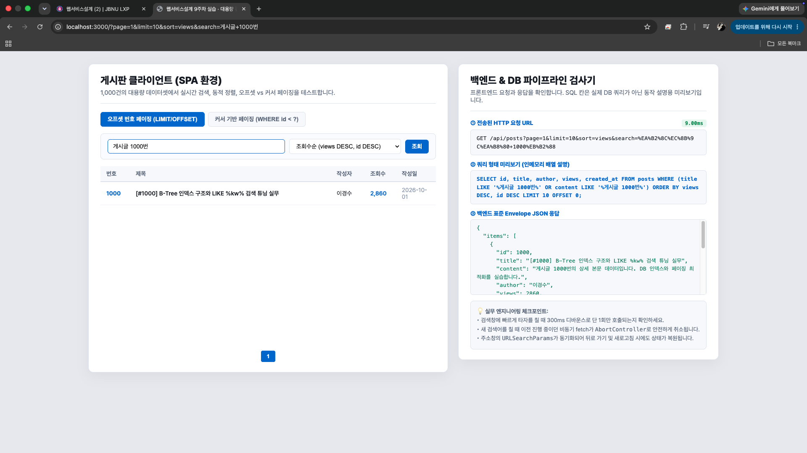 |
| 검색 결과 없음 | `없는검색어xyz` 입력 | 게시글이 없고 `items: []`, `totalCount: 0`, 검색 결과 없음 안내가 표시됩니다. | 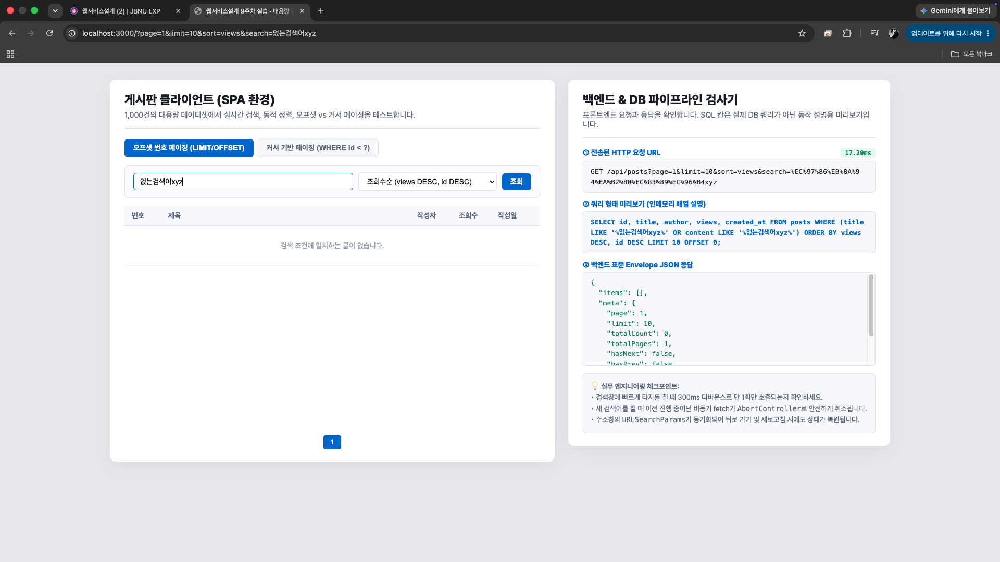 |
| 최신순 | `latest` 선택 | 작성일이 최신 날짜부터 표시됩니다. | 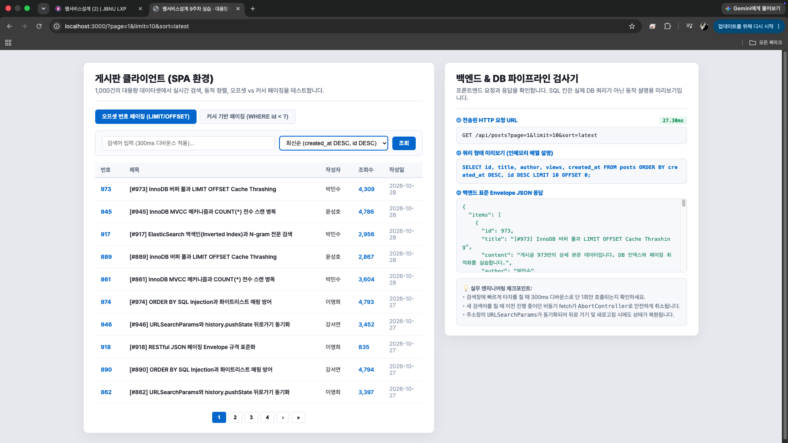 |
| 오래된순 | `oldest` 선택 | 작성일이 오래된 날짜부터 표시됩니다. 첫 날짜는 `2026-04-01`입니다. |  |
| 조회순 및 동점 ID | `views` 선택 후 Console에서 동점 ID 비교 | 조회수가 내림차순이며, 동점인 93쌍 모두 ID 내림차순 검사 결과 `PASS`입니다. | 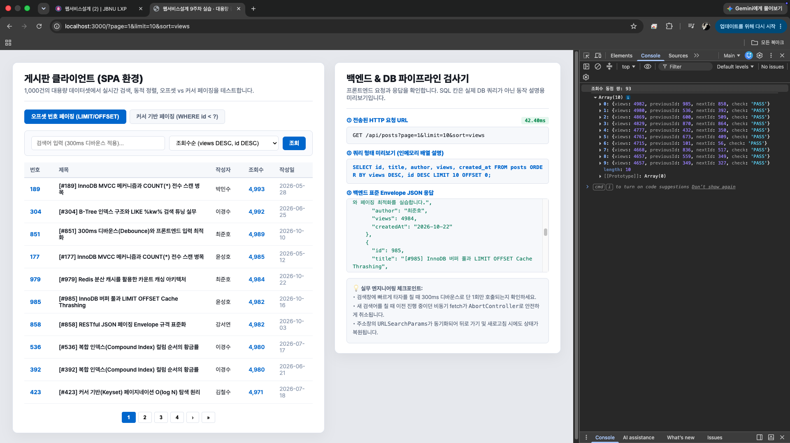 |
| 허용되지 않은 값의 기본 처리 | `sort=banana`와 `latest` 결과 ID 비교 | 두 요청의 ID 순서가 같고 Console에 잘못된 정렬 키가 `latest`로 처리됐다는 `PASS`가 출력됩니다. |  |
| 상속 속성 차단 | `sort=__proto__`, `sort=constructor` 비교 | 두 값 모두 허용된 정렬 키로 동작하지 않으며 최신순 결과와 ID가 같습니다. Console에 `PASS`가 표시됩니다. | 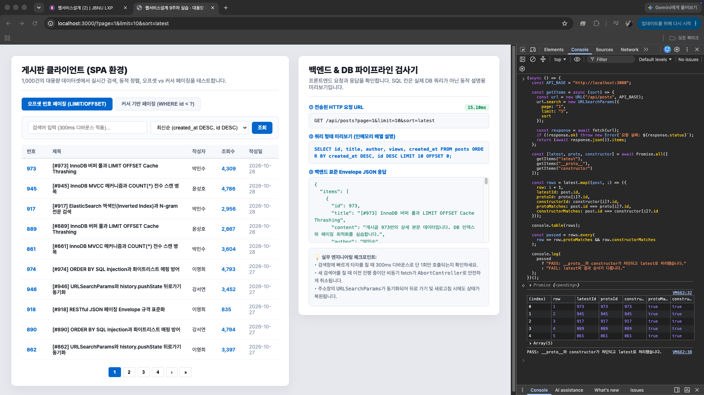 |

#### 2-2. 페이지네이션 

##### 구현 설명

- 오프셋 API `GET /api/posts`는 검색과 정렬을 먼저 적용한 다음 현재 페이지 구간을 반환합니다.
- 커서 API `GET /api/posts/cursor`도 제목·본문 검색을 지원합니다. 검색 조건과 `id < cursor`를 적용한 뒤 ID 내림차순으로 정렬하고, 그 결과에서 `limit + 1`개를 확인합니다.
- 커서 모드는 ID 내림차순으로 고정됩니다. UI에서 정렬 선택 메뉴를 비활성화하고 고정 기준을 안내합니다.
- 검색어가 바뀌면 프론트엔드는 기존 cursor와 누적 목록을 비우고 새 검색의 첫 요청부터 시작합니다.
- `hasNext`가 false면 더 보기 버튼을 비활성화하고 완료 문구를 표시합니다.

##### 오프셋 계산과 응답 meta

```text
offset = (page - 1) × limit
totalPages = max(1, ceil(totalCount / limit))
```

`page=2`, `limit=10`이면 `offset=10`으로, 정렬된 검색 결과의 11번째부터 20번째까지 가져옵니다. `totalPages`는 전체 검색 결과 수를 페이지 크기로 나눈 값을 올림한 것입니다. 검색 결과가 0건일 때도 페이지 수가 최소 1로 유지됩니다.

##### 항목별 테스트 및 캡처

| 세부 검증 | 입력·방법 | 기대 및 캡처에서 확인한 실제 결과 | 증거 |
| :--- | :--- | :--- | :--- |
| 오프셋 페이지 이동·meta | `page=2&limit=10&sort=oldest` 요청 | 응답 meta에서 `page=2`, `limit=10`, `totalCount=1000`, `totalPages=100`, `hasPrev=true`, `hasNext=true`를 확인했습니다. `offset=10`은 SQL 형태 미리보기에서 확인했습니다. | 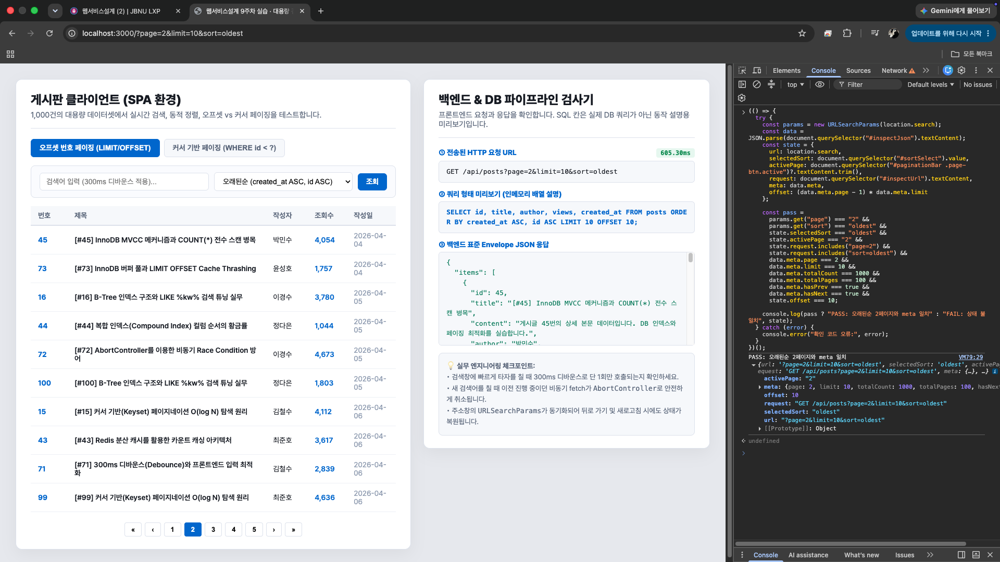 |
| 잘못된 page·limit | `page=0`, `-1`, `abc`, `limit=1000` 요청 | 세 잘못된 page 값은 `page=1`로, `limit=1000`은 상한 `100`으로 보정됩니다. 데이터 1,000건 기준 `totalPages=10`입니다. | 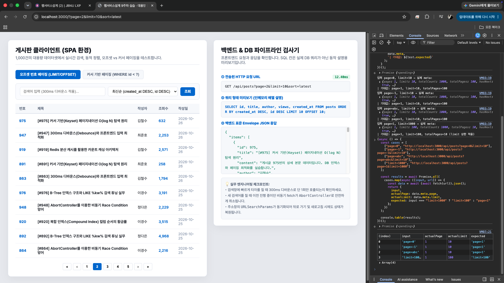 |
| 검색·정렬 변경 후 초기화 | 2페이지에서 검색어를 변경하고, 다시 2페이지에서 정렬을 변경 | 두 경우 모두 URL의 page가 1로 바뀌고 Console 검사가 각각 `PASS`입니다. |  |
| 커서 제목·본문 검색 및 검색 이후 `limit + 1` | 제목 `B-Tree`, 본문 `게시글 1000번` 검색 후 다음 커서 요청 | 두 검색 모두 일치 결과를 반환하고 다음 커서 요청에도 검색어 조건이 이어집니다. limit 3 검사에서 다음 데이터가 있어 `hasNext=true`와 `nextCursor`를 확인했습니다. 화면 미리보기의 기본 limit 10은 `TAKE 11`입니다. | 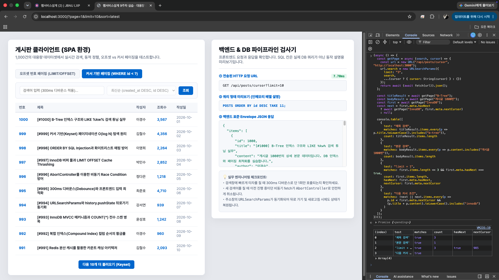 |
| ID 내림차순·정렬 메뉴 비활성화 | 커서 탭 선택 후 Console에서 ID와 disabled 확인 | ID `1000`부터 `991`까지 감소하고 정렬 메뉴 disabled 검사가 `true`입니다. | 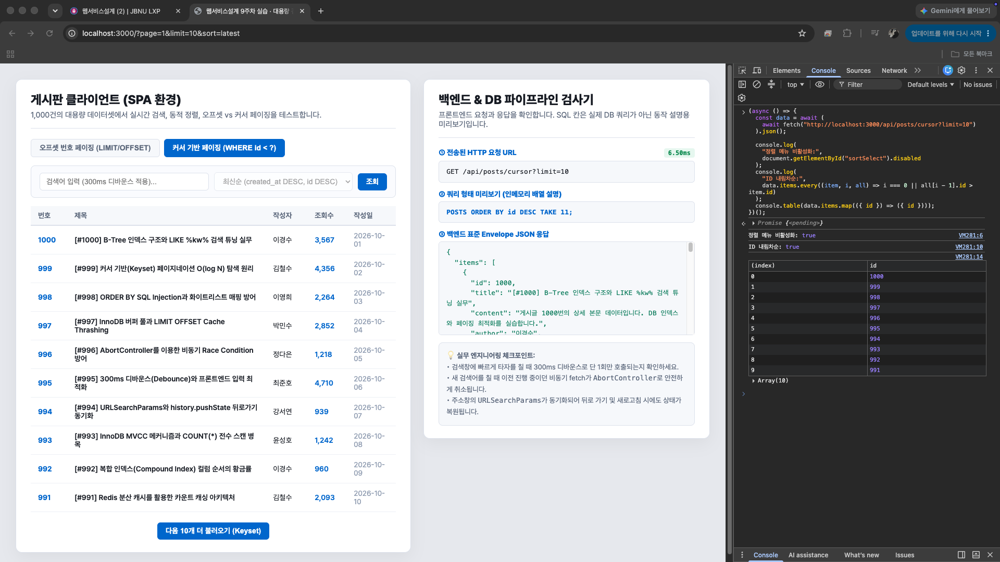 |
| 끝까지 조회·연속성 검사 | `InnoDB` 검색을 cursor로 마지막까지 반복 요청 | 17회 요청에서 167건을 수집했습니다. 중복 0, 순서 오류 0, 검색 불일치 0, 마지막 `hasNext=false`, Console `PASS`입니다. | 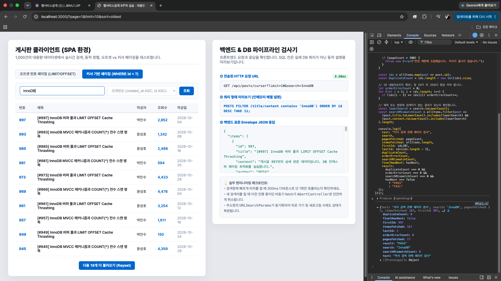 |
| 검색어 변경 시 목록·커서 초기화 | 기존 결과를 30건 누적한 뒤 `InnoDB` 검색 | 새 결과 10건이 새 검색의 첫 API 페이지 ID와 일치하고 `PASS`입니다. 이전 검색의 누적 목록은 이어지지 않습니다. |  |
| 마지막 페이지 버튼 상태 | `게시글 1000번` 검색 | 결과 1건, `hasNext=false`, 더 보기 버튼 disabled, Console `PASS`입니다. | 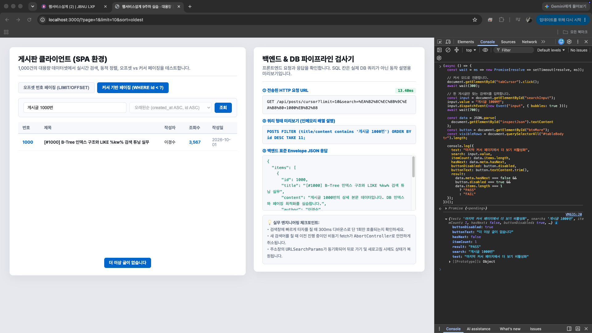 |
| 누락·추가·중복 대조 | 오프셋 검색 결과와 전체 커서 결과의 ID 집합 비교 | 양쪽 모두 167건이며 누락 0, 추가 0, 중복 0, Console `PASS`입니다. 표시 정렬 순서가 다를 수 있으므로 ID 집합으로 비교했습니다. | 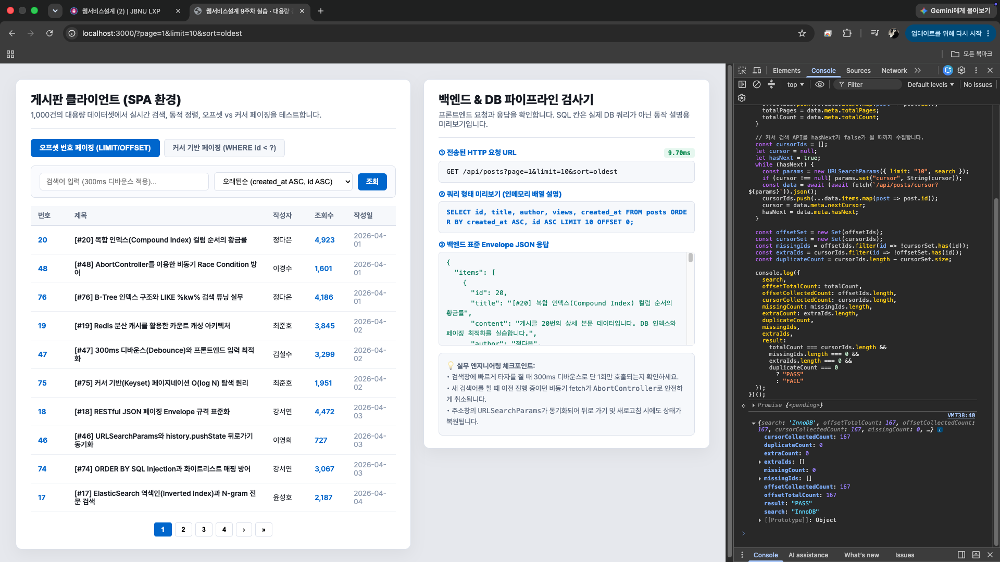 |

#### 2-3. 비동기 처리 

##### 구현 설명

- 검색 입력 이벤트마다 기존 debounce 타이머를 지우고 300ms 타이머를 새로 설정합니다. 입력이 이어지는 동안에는 요청을 보내지 않고, 입력이 멈춘 뒤 마지막 검색어로 요청합니다.
- 요청마다 `AbortController`를 사용합니다. 다음 입력이나 요청이 발생하면 앞선 요청을 abort합니다.
- 요청 sequence 번호를 함께 검사해 오래된 요청의 응답이 늦게 도착하더라도 최신 결과 화면을 덮어쓰지 않게 합니다.
- `AbortError`는 일반 오류와 구분해 안전하게 처리합니다. 그 외 오류만 실제 fetch 오류로 기록합니다.
- 응답 시간은 브라우저에서 관찰된 값이며, 캡처마다 달라질 수 있습니다.

##### 항목별 테스트 및 캡처

| 세부 검증 | 입력·방법 | 기대 및 캡처에서 확인한 실제 결과 | 증거 |
| :--- | :--- | :--- | :--- |
| 300ms 디바운스 | 입력 이벤트 6회를 100ms 간격으로 발생시킴 | 300ms보다 짧은 간격으로 입력했을 때 마지막 `InnoDB` 요청 1회만 기록되고 `PASS`입니다. | 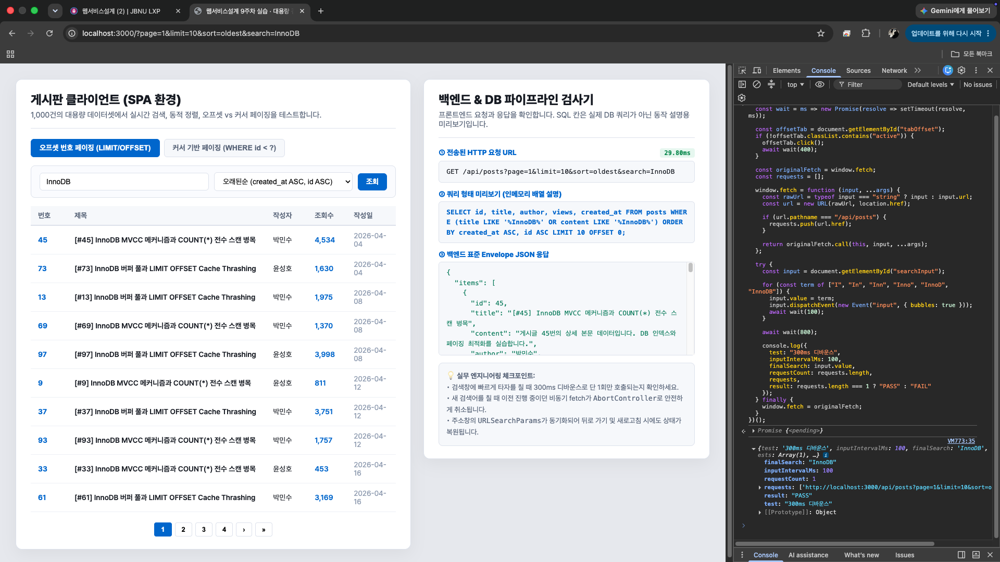 |
| `AbortController` 신호·늦은 응답 방지 | `B-Tree` 응답을 지연시키고 그 사이 `InnoDB` 검색 | 이전 요청의 `signal.aborted`가 true이고, 지연된 이전 응답이 도착해도 화면은 `InnoDB` 결과를 유지합니다. 지연 응답 경합을 재현하는 시험에서는 첫 fetch의 signal 전달을 차단해 오래된 응답 방지 동작을 별도로 확인했습니다. 실제 네트워크 요청 취소는 다음 행의 Slow 4G 시험으로 확인했습니다. | 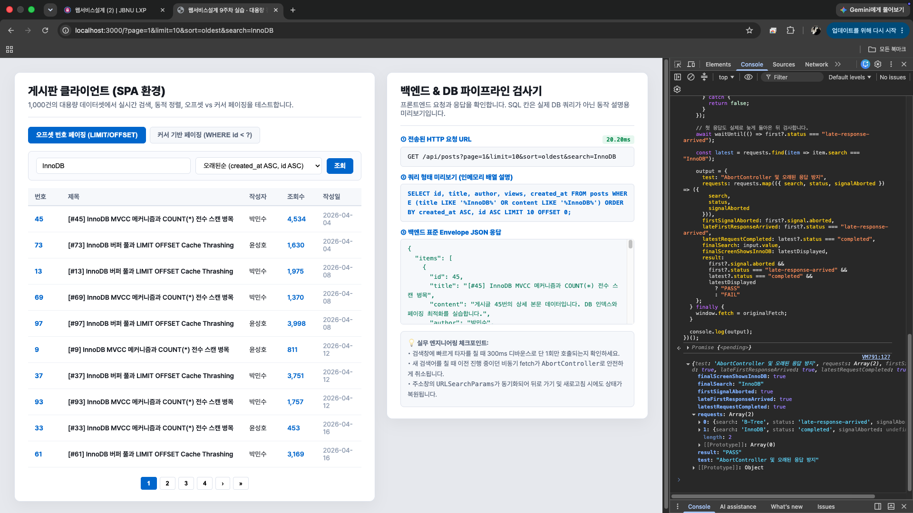 |
| `AbortError` 안전 처리 | 특정 요청에서 테스트용 `AbortError`를 발생시킴 | 취소 로그가 감지되고 처리되지 않은 Promise 오류가 없어 `PASS`입니다. | 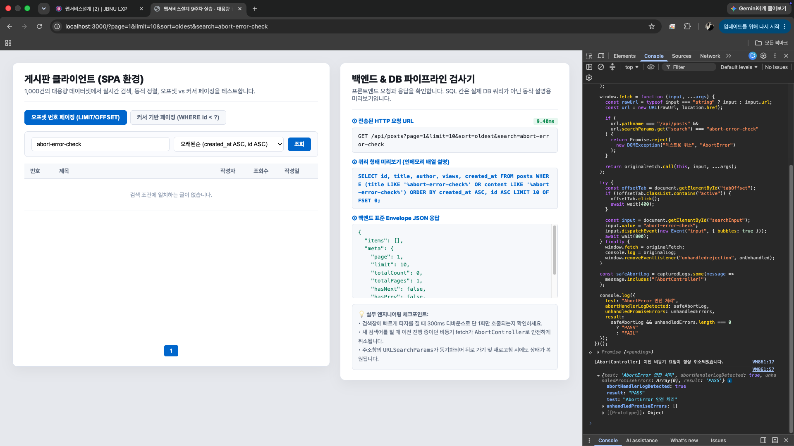 |
| 느린 네트워크 검색 변경·요청 취소 | Network 탭을 `Slow 4G`로 설정하고, 검색 요청이 진행되는 동안 검색어를 변경 | Network 목록에 취소된 이전 `fetch`와 완료된 최종 `200` 요청이 표시됩니다. 검색창과 결과는 최종 검색어 `InnoDB`에 일치합니다. 응답 시간은 화면 관찰값이며 고정 성능 지표가 아닙니다. |  |

#### 2-4. URL 상태 복원 

##### 구현 설명

- 오프셋 요청 상태는 `URLSearchParams`로 `page`, `limit`, `sort`, `search`를 직렬화해 URL에 반영합니다.
- 검색·정렬·페이지 이동은 `history.pushState()`로 히스토리 항목을 만듭니다.
- 새로고침 때 URL의 파라미터를 읽어 검색창과 정렬 메뉴를 채우고 해당 페이지 결과를 요청합니다.
- `popstate` 이벤트에서도 URL을 다시 읽고 UI 입력값과 목록을 복원합니다.

##### 항목별 테스트 및 캡처

| 세부 검증 | 입력·방법 | 기대 및 캡처에서 확인한 실제 결과 | 증거 |
| :--- | :--- | :--- | :--- |
| `URLSearchParams` 동기화 | `B-Tree` 검색, `oldest` 선택, 2페이지 이동 | URL의 `search=B-Tree`, `sort=oldest`, `page=2`가 입력창·정렬 선택·활성 페이지와 일치하고 `PASS`입니다. | 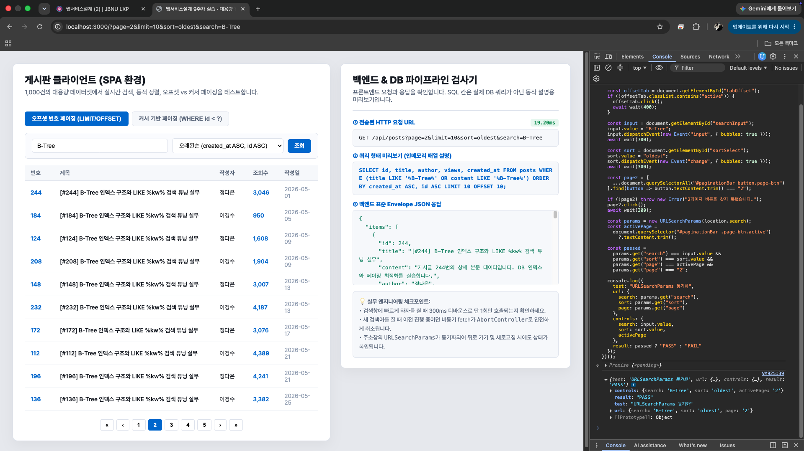 |
| 새로고침·뒤로 가기 복원 | 저장된 2페이지 상태에서 새로고침 후 뒤로 가기 | 새로고침 후 2페이지 상태, 뒤로 가기 후 1페이지 상태로 복원됩니다. 두 상태의 URL·검색창·정렬·응답 결과가 일치하고 전체 `PASS`입니다. |  |

### 3. 페이지네이션 개념 정리

#### 3-1. 오프셋과 커서는 어떤 화면에 적합한가

- **오프셋 방식**은 페이지 번호를 직접 선택하거나 전체 페이지 수를 보여주는 게시판·관리 화면에 적합합니다. 원하는 페이지로 바로 이동하기 쉽습니다. 대신 뒤쪽 페이지로 갈수록 앞의 많은 행을 건너뛰어야 할 수 있고, 조회 도중 데이터가 추가·삭제되면 페이지 경계에서 항목이 밀리거나 반복될 수 있습니다.
- **커서 방식**은 피드나 무한 스크롤처럼 다음 항목을 이어서 보여주는 화면에 적합합니다. 직전 결과의 마지막 ID를 다음 기준으로 사용하므로 큰 페이지 번호를 계산하지 않아도 됩니다. 임의 페이지로 바로 이동하거나 전체 페이지 수를 표시하는 사용 사례에는 덜 적합합니다.
- 이 예제의 커서 정렬 키는 ID 내림차순으로 고정합니다. 다음 요청은 `id < nextCursor` 조건을 사용해 직전 페이지보다 오래된 ID를 가져옵니다.

#### 3-2. 디바운스와 요청 취소의 역할

- **디바운스**는 입력이 잠시 멈출 때까지 기다려 연속 타이핑 중 발생하는 요청 횟수를 줄입니다. 300ms 디바운스는 마지막 입력 후 300ms 동안 추가 입력이 없을 때 검색을 요청합니다.
- **요청 취소**는 이미 보낸 요청이 진행 중인 상태에서 검색어가 바뀌었을 때 이전 요청의 작업을 중단하도록 합니다.
- 두 기능은 목적이 다릅니다. 디바운스는 요청을 보내기 전 호출 빈도를 줄이고, AbortController는 이미 진행 중인 요청을 취소합니다. 요청 sequence 검사는 취소가 늦거나 응답이 경합하는 상황에서 오래된 결과가 화면을 덮는 것을 막습니다.

#### 3-3. `limit + 1` 원리

화면에 `limit`개만 보여주더라도 서버가 후보 결과에서 한 건을 추가로 확인하면 다음 항목이 있는지 알 수 있습니다. 후보가 `limit + 1`개 이상이면 `hasNext=true`로 설정하고, 실제 응답에서는 여분 1개를 제외합니다. 후보가 `limit`개 이하라면 `hasNext=false`입니다. 커서 방식은 이 방법으로 다음 페이지 존재 여부를 판단하며 전체 건수 조회를 하지 않습니다.

#### 3-4. `offset`과 `totalPages` 계산식

```text
offset = (page - 1) × limit
totalPages = max(1, ceil(totalCount ÷ limit))
```

예를 들어 `page=2`, `limit=10`이면 `offset=10`입니다. `totalCount=1000`, `limit=10`이면 `totalPages=100`입니다. `totalCount=0`일 때는 화면에서 페이지 1을 유지할 수 있도록 `totalPages`의 최소값을 1로 둡니다.

### 4. 검증 범위와 AI 활용

- 응답 시간은 캡처 당시의 관찰값이며 하드웨어·브라우저·네트워크 상태에 따라 달라집니다. 1,000건 인메모리 예제이므로 실제 DB 인덱스의 시간 복잡도를 증명하는 자료로 해석하지 않습니다.
- 검색·정렬, 페이지네이션, 비동기 처리, URL 상태 복원은 표에 제시한 입력 조건으로 확인했습니다. 비동기 검증은 300ms 입력 간격 시험, 제어된 응답 지연 시험, `AbortError` 처리 시험, Slow 4G 네트워크 요청 상태 확인으로 구성했습니다.
- **AI 활용:** AI를 사용해 서비스 구현을 완료하고, 검증 가이드 및 README 초안 작성을 요청했습니다.
